# Parallel map

Dependency readiness is necessary but not sufficient: the coordinator also claims exclusive resources and verifies allowed paths. All backend changes conservatively share api-source; frontend ui-source is independent. This deliberately permits backend/frontend/test-review pipelines without promising collision-free simultaneous edits to the shared Java model. Read-only reviews of frozen candidates may overlap any independent developer. Model qualification has a single model-runtime lease.

```mermaid
flowchart TD
  T0001_001["T0001-001 readiness"]
  T0001_002["T0001-002 preparation"]
  T0001_001 --> T0001_002
  T0001_003["T0001-003 backend"]
  T0001_002 --> T0001_003
  T0001_004["T0001-004 frontend"]
  T0001_002 --> T0001_004
  T0001_005["T0001-005 backend"]
  T0001_003 --> T0001_005
  T0001_006["T0001-006 backend"]
  T0001_005 --> T0001_006
  T0001_007["T0001-007 frontend"]
  T0001_004 --> T0001_007
  T0001_006 --> T0001_007
  T0001_008["T0001-008 backend"]
  T0001_006 --> T0001_008
  T0002_001["T0002-001 readiness"]
  T0001_007 --> T0002_001
  T0001_008 --> T0002_001
  T0002_002["T0002-002 backend"]
  T0002_001 --> T0002_002
  T0002_003["T0002-003 frontend"]
  T0002_002 --> T0002_003
  T0002_004["T0002-004 frontend"]
  T0002_003 --> T0002_004
  T0002_005["T0002-005 qualification"]
  T0002_004 --> T0002_005
  T0003_001["T0003-001 readiness"]
  T0002_005 --> T0003_001
  T0003_002["T0003-002 backend"]
  T0003_001 --> T0003_002
  T0003_003["T0003-003 backend"]
  T0003_002 --> T0003_003
  T0003_004["T0003-004 backend"]
  T0003_003 --> T0003_004
  T0003_005["T0003-005 backend"]
  T0003_004 --> T0003_005
  T0003_006["T0003-006 frontend"]
  T0003_003 --> T0003_006
  T0003_005 --> T0003_006
  T0003_007["T0003-007 qualification"]
  T0003_006 --> T0003_007
  T0004_001["T0004-001 readiness"]
  T0002_005 --> T0004_001
  T0004_002["T0004-002 backend"]
  T0004_001 --> T0004_002
  T0004_003["T0004-003 backend"]
  T0004_002 --> T0004_003
  T0004_004["T0004-004 frontend"]
  T0004_002 --> T0004_004
  T0004_005["T0004-005 frontend"]
  T0004_003 --> T0004_005
  T0004_004 --> T0004_005
  T0004_006["T0004-006 qualification"]
  T0004_005 --> T0004_006
  T0005_001["T0005-001 readiness"]
  T0003_007 --> T0005_001
  T0005_002["T0005-002 backend"]
  T0005_001 --> T0005_002
  T0005_003["T0005-003 backend"]
  T0005_002 --> T0005_003
  T0005_004["T0005-004 backend"]
  T0005_002 --> T0005_004
  T0005_005["T0005-005 backend"]
  T0005_003 --> T0005_005
  T0005_004 --> T0005_005
  T0005_006["T0005-006 backend"]
  T0005_005 --> T0005_006
  T0005_007["T0005-007 frontend"]
  T0005_006 --> T0005_007
  T0006_001["T0006-001 readiness"]
  T0004_006 --> T0006_001
  T0005_007 --> T0006_001
  T0006_002["T0006-002 backend"]
  T0006_001 --> T0006_002
  T0006_003["T0006-003 backend"]
  T0006_002 --> T0006_003
  T0006_004["T0006-004 backend"]
  T0006_003 --> T0006_004
  T0006_005["T0006-005 backend"]
  T0006_004 --> T0006_005
  T0006_006["T0006-006 frontend"]
  T0006_003 --> T0006_006
  T0006_005 --> T0006_006
  T0007_001["T0007-001 readiness"]
  T0006_006 --> T0007_001
  T0007_002["T0007-002 backend"]
  T0007_001 --> T0007_002
  T0007_003["T0007-003 frontend"]
  T0007_002 --> T0007_003
  T0007_004["T0007-004 qualification"]
  T0007_003 --> T0007_004
  T0008_001["T0008-001 readiness"]
  T0007_004 --> T0008_001
  T0008_002["T0008-002 qualification"]
  T0008_001 --> T0008_002
  T0008_003["T0008-003 qualification"]
  T0008_001 --> T0008_003
  T0008_004["T0008-004 qualification"]
  T0008_001 --> T0008_004
  T0008_005["T0008-005 qualification"]
  T0008_002 --> T0008_005
  T0008_003 --> T0008_005
  T0008_004 --> T0008_005
```

## Candidate waves
- Wave 1: T0001-001
- Wave 2: T0001-002
- Wave 3: T0001-003, T0001-004
- Wave 4: T0001-005
- Wave 5: T0001-006
- Wave 6: T0001-007, T0001-008
- Wave 7: T0002-001
- Wave 8: T0002-002
- Wave 9: T0002-003
- Wave 10: T0002-004
- Wave 11: T0002-005
- Wave 12: T0003-001, T0004-001
- Wave 13: T0003-002, T0004-002
- Wave 14: T0003-003, T0004-003, T0004-004
- Wave 15: T0003-004, T0004-005
- Wave 16: T0003-005, T0004-006
- Wave 17: T0003-006
- Wave 18: T0003-007
- Wave 19: T0005-001
- Wave 20: T0005-002
- Wave 21: T0005-003, T0005-004
- Wave 22: T0005-005
- Wave 23: T0005-006
- Wave 24: T0005-007
- Wave 25: T0006-001
- Wave 26: T0006-002
- Wave 27: T0006-003
- Wave 28: T0006-004
- Wave 29: T0006-005
- Wave 30: T0006-006
- Wave 31: T0007-001
- Wave 32: T0007-002
- Wave 33: T0007-003
- Wave 34: T0007-004
- Wave 35: T0008-001
- Wave 36: T0008-002, T0008-003, T0008-004
- Wave 37: T0008-005

## Integration policy
One coordinator owns state and integration. Each task starts from the latest integrated commit after all dependencies are DONE. Changes outside its allowlist block. A merge conflict is returned to the task author in its own branch; never auto-resolve semantically. Integration reruns gates and independent approvals on the merged content before publishing DONE. Reviews never approve a moving worktree.
