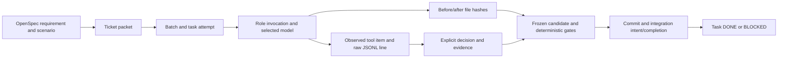

# Workflow evidence, observability and recovery

This is the operating contract for the local coordinator. Verification of these changes did not launch a model, coding agent or application acceptance run. Offline fixtures must never be presented as real agent activity. See [verification](../verification.md) for observed checks and publication evidence.

## What proves the workflow works

| Evidence layer | What it proves | What it does not prove |
|---|---|---|
| Policy and unit tests | Resolution, budget arithmetic, unknown-data blocking, artifact and state invariants | Provider availability or quality |
| Failure-injection tests | Contention, abrupt process death, preserved history, unresolved invocation/merge blocking, backup corruption detection | Arbitrary hardware failure or lost disks |
| Complete offline workflow fixture | Real coordinator handoffs, independent session IDs, immutable candidate gates, attribution and disposable Git integration; rejection prevents downstream tests/DONE | Real model, Java/React behavior, actual service readiness or product acceptance |
| Existing analyzer/runtime fixtures | Tool adapters and selected positive/negative checks | Acceptance of the current application seed |
| Future T0009-007 live qualification | Actual selected provider/model/effort, tool round trip, structured events and accounting | Full feature acceptance |
| Future ticket/release qualification | Real environment, static checks, selected tests, browser evidence and product scenarios for the frozen candidate | Future uptime or future model behavior |

The full offline fixture replaces only external model/service/test adapters and uses a disposable Git repository. It exercises the real coordinator stage transitions, result envelopes, model admission checks with explicitly synthetic receipts, history, gate decision and merge path. A second fixture rejects code review and verifies that tests, merge and DONE never occur. No production receipt is manufactured from these fixtures.

T0009-013 adds regressions for stops after integration intent and during a real disposable Git merge, serialization of finalization with stop writers, coordinator SIGKILL with harmless child/grandchild processes, missing databases/rows, and missing or changed gate evidence. Ordinary completion and an independent deadline are tested through the real local supervisor; no model executable is launched.

Additional live tests are still necessary before unattended execution: each requested model's catalog/event/effort behavior; actual credential/provider errors; representative Java/React ticket including rejection/repair; actual Playwright application flows; stop/restart during a real sandboxed run; and provider-cost reconciliation. They are deliberately not run under the current prohibition. Offline tests cannot honestly replace these checks.

## Storage and authority

All runtime data is local under the execution repository's `.execution/`, outside Git and outside agent write allowlists. It must live on a persistent local disk, not an ephemeral container filesystem or a shared network mount. Application data remains in its task-specific service volumes.

| Artifact | Authority / content |
|---|---|
| `state.sqlite` | Current task status, owner, commit, exclusive leases; transactionally recorded state events including claim/release/owner/commit |
| `budgets.sqlite` | Separate pool reservations, observed tokens, estimated USD, pinned price snapshot, settlement and persistent stops |
| `trace.sqlite` | Ordered append-only workflow journal; global sequence, event UUID/time, task, attempt, session, role, payload and previous-event hash |
| `runs/<attempt>/.../*.input.json` | Redacted assigned prompt, selected model/effort and requirement/acceptance context |
| `*.events.jsonl`, `*.stderr.log` | Redacted CLI event stream and diagnostics, flushed/fsynced as they arrive |
| `*.changes.json` | Observed before/after hashes of files in the ticket's write scope, linked to the invocation |
| `*.result.json`, `*.execution.json` | Explicit agent decision plus coordinator-owned duration, usage, budget and trace metadata |
| Stage reports / `gate.json` | Candidate identity, actor/session, raw test/browser/static artifacts and hashes, deterministic outcome |
| `runs/<attempt>/.../static-evidence/` | Durable copies of verified analyzer outputs, independent of disposable analyzer caches |
| `usage.jsonl` | Append-only invocation accounting rollup; not the sole recovery authority |
| `worktrees/`, `integration/` and Git refs | Actual source changes, task branches, integration commits and retained interrupted work |

`trace.sqlite` uses WAL and FULL synchronous transactions. State/budget writes use SQLite transactions and FULL synchronous durability. JSON receipts use unique temporary files, fsync and atomic replace. The raw event file is persisted before its journal index record. Sequence numbers represent coordinator observation order, not a total causal order inside concurrent providers. Task/attempt/session/item identifiers establish the relevant links.

The three databases and Git/filesystem do **not** share one atomic transaction. A crash between them is possible and is represented as unresolved work; it is not guessed away. Hash chains and artifact hashes detect accidental edits, gaps and changed content when compared with retained evidence/backups. They are not signatures or protection against a local administrator rewriting the complete chain or removing its tail. There is no claim of a complete OS syscall audit.

## Follow a requirement to the outcome



`task.claimed` snapshots the ticket's requirement/acceptance IDs and scope. Each invocation has an attempt ID, batch ID when scheduled, role, unique session, model/provider/effort and iteration path. CLI `thread_id` and item ID remain observable fields; they are not substituted for the coordinator session. `cli.event` indexes tool type, command/MCP arguments/status and the raw file/line/hash. Commands, exit codes and file-change events are evidence of what the CLI emitted; a start event alone never proves successful completion or an external side effect.

The developer's before/after file hashes provide independent change evidence within the assigned scope. Scope checks still reject other writes. Commit/integration events connect the change to Git. Review reports identify the independent session and candidate hash. An integration intent is persisted before merge, followed by completion and task DONE; a crash in between requires comparing actual Git HEAD and gate artifacts.

For “why”, inspect the exact assignment, the agent's explicit `summary`, `findings`, `evidence` and the deterministic gate's pass/failure reason. These are auditable explanations, not hidden model reasoning. A model's approval is a claim until the raw gate artifacts agree. Different roles are separately identified even when they use the same model.

## Inspect observed actions without running an agent

From this repository root:

```sh
python3 tools/inspect_execution.py timeline --task T0002-002
python3 tools/inspect_execution.py verify-history
python3 tools/inspect_execution.py recovery
python3 tools/orchestrate.py usage
python3 tools/orchestrate.py budgets
```

These commands make no provider requests. An empty timeline means no recorded run, not a successful run. During a future run, repeat the timeline command to view the newest committed events; open the referenced private JSONL line for full emitted tool output. No web dashboard or external telemetry collector is installed. The journal contains private source/prompts/tool arguments; do not paste it into public issues. Known provider credential values are redacted, but unrelated sensitive content still requires review before sharing.

## What survives restart

| Interruption point | Surviving evidence and required behavior |
|---|---|
| Before process launch | Reservation and invocation input/start intent; no assumption that a call was free unless failure-to-start was actually recorded |
| During a tool/model turn | Committed raw events/journal, task claim and budget reservation; process may have performed side effects after the last observed event |
| After usage, before final receipt | Updated reservation/known consumption; unfinished invocation blocks restart |
| After commit or merge intent | Git objects/worktree plus intent; inspect actual HEAD before deciding whether the operation completed |
| After DONE | State event, integration commit, completed trace and gate evidence remain available |

Startup checks recovery **before any billable preflight**. Outstanding task ownership, leases, invocations, integration intents, unknown budget usage, budget stops or legacy state without a correlated journal block launch. Retained task events must agree with task rows, owners and completion commits; invocation sessions must have accounting records. Missing databases or rows block before recreation. A missing or empty journal with retained run/preflight/batch/worktree/integration entries, policy/result/stop files or orphaned database sidecars now blocks, even if every database and usage.jsonl was lost. Empty attempt directories count as evidence; empty artifact roots do not. Empty directories and complete preflight-only histories remain valid without a task database. Standalone preflight and explicit retry inspect recovery under the coordinator lock before writing attempt reports or task state. Expired leases are never stolen. `retry` does not clear unknown budgets or reconcile an interrupted merge.

Each invocation has an independent POSIX supervisor. A coordinator-owned pipe closes on coordinator death, including SIGKILL; the supervisor also enforces an independent deadline. A live group anchor preserves ownership while TERM then KILL cleans up the invocation group, including descendants that ignore TERM. The anchor's result pipe preserves the CLI exit status and standard streams. Cleanup uses live ownership, never a PID recovered from disk. The polling interval is 100 ms and TERM grace is 200 ms under normal OS scheduling. This does not undo remote requests already accepted, cover deliberately escaped process groups, or survive simultaneous supervisor/OS failure. Unknown usage stays reserved, and incomplete history still requires reconciliation.

The budget is checked again after integration intent. After Git returns, final state and completion events are published while a short accounting transaction serializes them with stop writers. A committed stop before that boundary blocks DONE. A stop during merge can leave a real Git side effect: the task is BLOCKED, the intent remains unresolved and there is no automatic rollback. Finalization that completed before a later stop remains completed; delayed telemetry cannot provide retroactive pre-consumption guarantees.

Follow the [blocked-execution recovery runbook](recovery-runbook.md) for decision records, case-specific actions and retry criteria. Recovery is conservative rather than exactly-once replay:

1. Stop/identify the old coordinator and its child processes; do not start a second owner. Inspect `recovery` and the last task/session events.
2. Preserve an audit backup and the actual worktrees/Git refs/application data before repair.
3. Inspect real file/DB/external effects and compare integration HEAD with `integration.intent` and immutable gate evidence. A missing completion event is not proof that nothing happened.
4. Reconcile usage and any unknown charge using retained receipts/provider evidence. Confirm a reviewed correction to ownership/state; do not delete ledgers or run blanket SQL resets.
5. Requalify environment/model admission and explicitly authorize the affected retry. A fresh attempt is separate from the previous one; review and tests rerun for changed content.

The tool currently provides inspection and audit restoration, **not an automatic task/budget reconciliation command**. This is deliberate: unknown external side effects cannot safely be retried from a generic status row. A concrete interrupted run needs a reviewed recovery decision. `--ephemeral` model sessions also mean restoring the audit does not resume the model's internal conversation; the preserved prompt/results support a new qualified attempt.

## Backup and restore of the audit

```sh
# Future operator commands; choose fresh private directories on persistent storage.
python3 tools/inspect_execution.py backup --execute \
  --destination /absolute/private/stone-audit-backup-001
python3 tools/inspect_execution.py verify-backup \
  --audit-dir /absolute/private/stone-audit-backup-001
python3 tools/inspect_execution.py restore-audit --execute \
  --audit-dir /absolute/private/stone-audit-backup-001 \
  --destination /absolute/private/stone-audit-restored-001
python3 tools/inspect_execution.py timeline \
  --audit-dir /absolute/private/stone-audit-restored-001 --task T0002-002
```

Backup acquires the coordinator lock, uses SQLite's backup API, copies only allowlisted audit trees/files and records SHA-256 hashes. History/startup/backup verification checks stage envelopes, every recorded raw artifact and the gate file, in addition to invocation evidence and database consistency. Analyzer outputs are copied from cache into the run before admission and checked against their verified hashes. Restore applies the same checks in a **new** directory; it never overwrites active state or resumes execution. Missing or damaged evidence prevents a verified export; preserve damaged originals for explicit forensic reconciliation rather than deleting them to resume. Old gate events without file hashes require requalification. Symlinks and protected paths are rejected/excluded before traversal. Use canonical paths (macOS `/var` can be a symlink). Partial copies are unusable until `verify-backup` succeeds.

Export excludes environment files such as `stack.env`, `.env` and their case/backup variants, recognized credential files/directories and private keys before reading their metadata/content. Verification and restore reject these paths in both the manifest and unlisted archive contents. Required evidence pointing to an excluded file blocks export; history is never silently rewritten. Older archives containing these files must be treated as sensitive and re-exported from preserved source under the new policy. Arbitrary sensitive content inside permitted logs/databases is not automatically removed.

This is **not** a full machine/project backup: it excludes `.git`, working trees, application volumes, secret stores and model context. Source Git refs and uncommitted changes need a separate authorized source backup; databases/storage need their own application backups. A restored audit can explain history but cannot recreate source or business data it never contained. Existing absolute paths in older reports may refer to the original workspace; indexed new raw events are resolved within the audit copy. Restore-to-run relocation requires separate requalification.

Keep the verified audit on encrypted persistent storage, with an off-machine copy and access control if machine-loss recovery matters. No cloud upload, recurring schedule, external database or retention deletion is enabled here. A Git clone alone does not restore `.execution/`; deleting the private directory loses local history. Disk-loss recovery is only as recent as the last verified external backup.

## SQLite or another database

For one coordinator and at most three local workers, SQLite is a suitable choice: transactions, short serialized writes, private persistent files and no additional service dependency. It should not be replaced merely because the process restarts. SQLite documents the distinction between local storage and client/server multi-host use in [Appropriate Uses for SQLite](https://sqlite.org/whentouse.html); consistent database copies use its [backup API](https://sqlite.org/backup.html).

Move to PostgreSQL when multiple machines/coordinators need concurrent ownership, centralized access control, managed replication/backup or higher write throughput. Store large traces/screenshots in private object storage and keep references/hashes in the database. Such a migration would also need distributed leases, fencing, idempotency and an event delivery strategy; changing only the DB driver would not supply those guarantees. None of these additional services is installed without approval.

## USD and token accounting

The default policy now uses schema 2 with separate `codex.limit_usd` and `openrouter.limit_usd`, both `0.00`. Each pool has a USD allowance per invocation. Tokens remain recorded and grouped by task, role, iteration and selected model. The USD ledger uses integer microdollars; pricing uses decimal strings and conservative upward rounding, not binary floats.

To enable estimates later, configure positive limits plus exact pool/model rates for input, cached input and output, a source URL and expiry. Rates are snapshotted at reservation time. Missing/expired rates block, and a model switch cannot reuse another model's rate. A missing cached-token count receives no invented discount. Token-only historical ledgers cannot switch to USD without explicit reconciliation; they are never reset or repriced silently.

`estimated_cost_usd` is a configured estimate; `provider_reported_cost_usd` stays null in the current CLI adapter. Codex subscription usage is distinct from API pricing ([official OpenAI pricing guidance](https://learn.chatgpt.com/docs/pricing)). OpenRouter's direct API supplies usage/cost fields ([usage accounting](https://openrouter.ai/docs/cookbook/administration/usage-accounting)), but their preservation by this Codex CLI adapter has not been qualified. The wrapper therefore does not pretend to have invoice-level cost or subscription balance. A future qualified provider-cost adapter/reconciliation can add actual values without overwriting the estimate.

Delayed turn-end usage can overrun either a token or estimated-USD allowance before the stop is observed. A local dollar guard is not a provider-side hard spending cap, and estimates exclude unconfigured fees/taxes/other tool charges. No real tariff is invented in the repository; the price table is empty and live execution remains blocked until explicitly configured and qualified.
